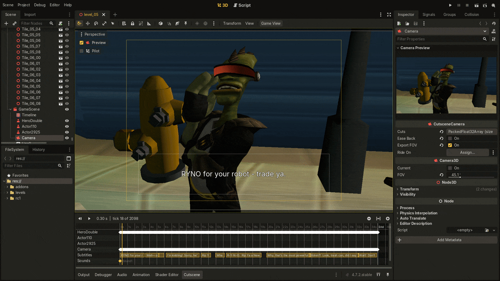
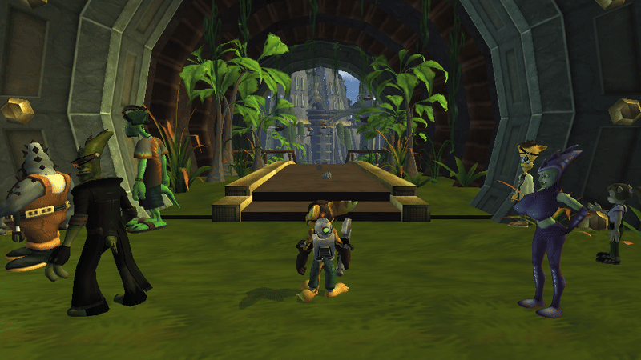
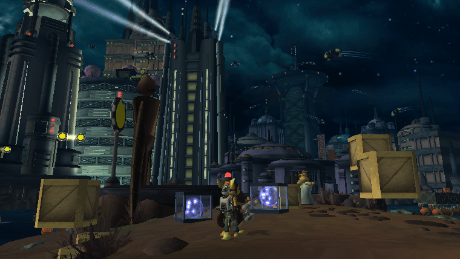
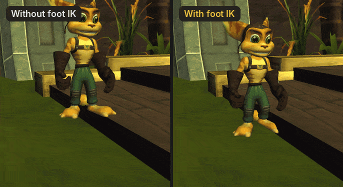

<h1 align="center">
  <a href="https://openrac.dev/">
    <picture>
      <source media="(prefers-color-scheme: dark)" srcset="docs/assets/openrac-editor-logo-dark.svg">
      
    </picture>
  </a>
</h1>

<p align="center">
  <strong>The level editor for Ratchet &amp; Clank.</strong><br>
  Open a planet from your own disc, change it, and play it in OpenRAC.
</p>

<p align="center">
  <a href="https://github.com/OpenRAC/OpenRAC/releases/latest"></a>
  <a href="https://openrac.dev/"></a>
  <a href="https://discord.gg/Sfd2B54PDG"></a>
</p>

<p align="center">
  <a href="#features">Features</a> ·
  <a href="#get-started">Get started</a> ·
  <a href="#build-from-source">Build from source</a> ·
  <a href="docs/README.md">Docs</a>
</p>

<p align="center">
  
</p>

## What is OpenRAC Editor?

OpenRAC Editor is the level editor of [OpenRAC](https://github.com/OpenRAC/OpenRAC), the native PC
version of the PlayStation 2 Ratchet & Clank games. It opens each planet as it is on your disc, with
its terrain, objects, collision and sky, and saves your changes in a form the game can load.

It is built on [Godot Engine](https://godotengine.org) and keeps its 3D tools, focused on
Ratchet & Clank levels.

## Features

### Bring characters from other planets

Drop Qwark from Oltanis, a Blarg trooper from Eudora or a turret from Gemlik into any level. They
keep their own logic: they walk their paths, guard their zones and fire their own shots, wherever
you put them.

<p align="center">
  
</p>

### Give objects a behaviour

Make an object spin, bob, patrol, orbit, or face or follow Ratchet, with no code. Pick a behaviour
in the Inspector and see it in the game.

<p align="center">
  
</p>

### Make your own cutscenes

Key the camera, place characters, give them lines, voices and music, all on one timeline. The game
plays your scene when its trigger happens, and Start skips it.

<p align="center">
  
</p>

Characters keep their feet on steps and slopes (foot IK), their mouths follow the voice, and
subtitles come in every language your disc has. See [the cutscene format](docs/CUTSCENE_FORMAT.md).

### Edit everything in the level

- **Objects:** move, copy or delete any moby, tie or shrub, and change what the game stores for it.
- **Collision:** see the ground Ratchet walks on, repaint it, move it or add new faces.
- **Level settings:** fog, sky colour, death height, cameras, sounds, paths and grind rails.

### Play your changes

The OpenRAC launcher packs your edits into a mod and starts the game with them. Your disc is never
changed.

### Work with an AI assistant

The built-in MCP server lets Claude or another assistant find, change and check objects for you.
See [MCP](docs/MCP.md).

## Get started

1. [Get the OpenRAC launcher](https://github.com/OpenRAC/OpenRAC/releases/latest) and add your disc.
2. In **Mods**, open the **Level editor** tab and press **Get the levels ready**.
3. Pick a planet and open it.

Edits play in Ratchet & Clank (PAL and NTSC-U). Levels of the later games open to explore.

**Guides:** [Level editor](https://github.com/OpenRAC/OpenRAC/blob/develop/editor/README.md) ·
[Map mods](https://github.com/OpenRAC/OpenRAC/blob/develop/editor/MAP_MODDING.md)

## Build from source

You need Python 3, SCons and a C++ compiler.

```sh
git clone https://github.com/nickyyOO/OpenRAC-Editor.git && cd OpenRAC-Editor
scons platform=linuxbsd profile=build/custom.py      # Linux
scons platform=windows profile=build/custom.py       # Windows
scons platform=macos arch=arm64 profile=build/custom.py metal=yes vulkan=no   # macOS
```

**More:** [Building](docs/BUILDING.md) · [Changes from Godot](docs/CHANGES.md) · [Contributing](CONTRIBUTING.md)

## Credits and license

OpenRAC Editor is built on Godot Engine, by Juan Linietsky, Ariel Manzur and the
[Godot Engine contributors](AUTHORS.md).
The logo's lettering is set in [Righteous](https://fonts.google.com/specimen/Righteous).

**See:** [License](LICENSE) · [Godot's license](LICENSE.txt) · [Third-party notices](COPYRIGHT.txt)

Godot is a trademark of the Godot Foundation; OpenRAC Editor is not made or endorsed by it.
OpenRAC is an unofficial fan project, not affiliated with or endorsed by the owners of
Ratchet & Clank. All trademarks belong to their owners.
