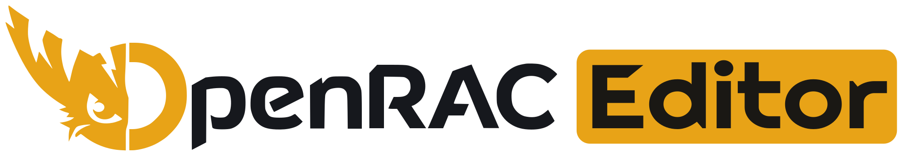
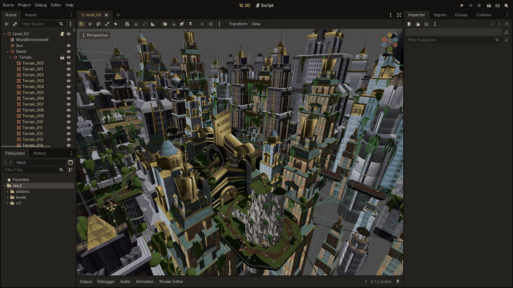
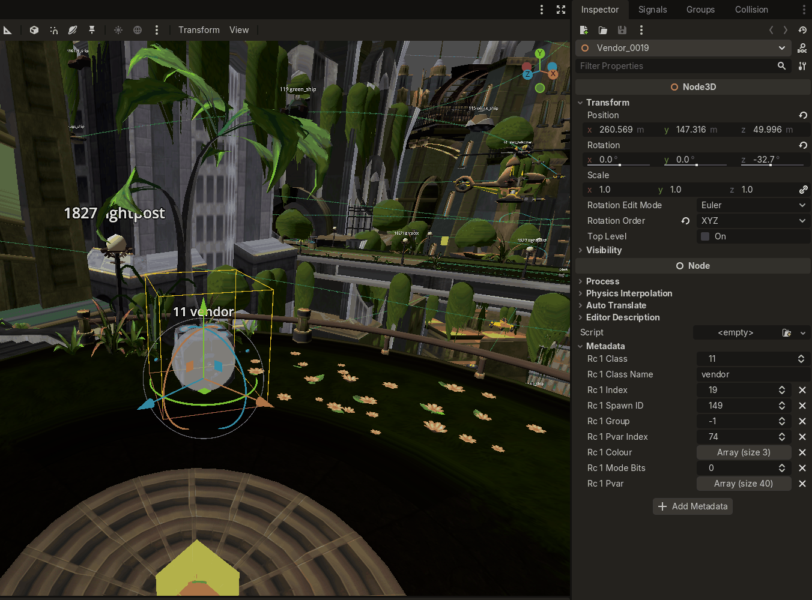
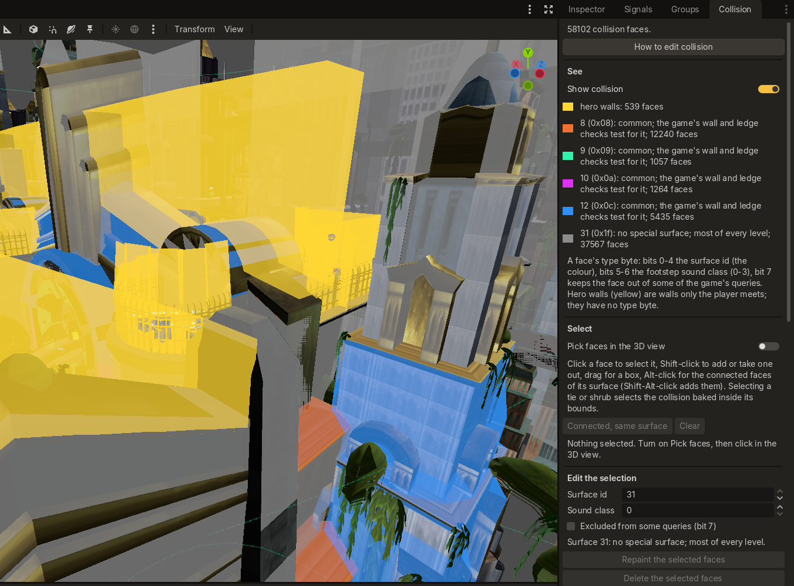

<h1 align="center">
  <a href="https://openrac.dev/">
    <picture>
      <source media="(prefers-color-scheme: dark)" srcset="docs/assets/openrac-editor-logo-dark.svg">
      
    </picture>
  </a>
</h1>

<p align="center">
  <strong>The level editor for Ratchet &amp; Clank.</strong><br>
  Open a planet from your own disc, change it, and play it in OpenRAC.
</p>

<p align="center">
  <a href="https://github.com/OpenRAC/OpenRAC/releases/latest"></a>
  <a href="https://openrac.dev/"></a>
  <a href="https://discord.gg/Sfd2B54PDG"></a>
</p>

<p align="center">
  <a href="#features">Features</a> ·
  <a href="#get-started">Get started</a> ·
  <a href="#build-from-source">Build from source</a> ·
  <a href="docs/README.md">Docs</a>
</p>

<p align="center">
  
</p>

## What is OpenRAC Editor?

OpenRAC Editor is the level editor of [OpenRAC](https://github.com/OpenRAC/OpenRAC), the native PC
version of the PlayStation 2 Ratchet & Clank games. It opens each planet as it is on your disc, with
its terrain, objects, collision and sky, and saves your changes in a form the game can load.

It is built on [Godot Engine](https://godotengine.org) and keeps its 3D tools, focused on
Ratchet & Clank levels.

## Features

### Every object, in the scene tree

Each moby, tie and shrub of a level is a node. Pick one in the 3D view or the scene tree, then move,
turn or scale it, copy it, or delete it. The inspector shows what the game stores for each moby,
such as its spawn id, group, colour and class variables, and your changes go back into the level.

<p align="center">
  
</p>

### Collision

The Collision panel draws the ground the game tests Ratchet against, coloured by surface type. Pick
faces in the 3D view to repaint, move or delete them, or add new ones on the game's grid. Each
kind of object has its own collision shapes to edit too, and every change can be undone.

<p align="center">
  
</p>

### Gameplay data

Change what each level starts with: fog and background colour, the height where Ratchet falls to
his death, where the ship lands, cameras, sounds, volumes, paths and grind rails.

### Play your changes

The OpenRAC launcher packs your edits into a mod and starts the game with them. Your disc image is
never changed. You can also build a whole new world and add it as a ship destination.

### Your own tools

Write your own editor tools and checks in GDScript. The class reference is built in: **Help > Search
Help**.

## Get started

1. [Get the OpenRAC launcher](https://github.com/OpenRAC/OpenRAC/releases/latest) and add your disc.
2. In **Mods**, open the **Level editor** tab and press **Get the levels ready**.
3. Pick a planet and open it.

Edits play in Ratchet & Clank (PAL and NTSC-U). Levels of the later games open to explore.

**Guides:** [Level editor](https://github.com/OpenRAC/OpenRAC/blob/develop/editor/README.md) ·
[Map mods](https://github.com/OpenRAC/OpenRAC/blob/develop/editor/MAP_MODDING.md)

## Build from source

You need Python 3, SCons and a C++ compiler.

```sh
git clone https://github.com/nickyyOO/OpenRAC-Editor.git && cd OpenRAC-Editor
scons platform=linuxbsd profile=build/custom.py      # Linux
scons platform=windows profile=build/custom.py       # Windows
scons platform=macos arch=arm64 profile=build/custom.py metal=yes vulkan=no   # macOS
```

**More:** [Building](docs/BUILDING.md) · [Changes from Godot](docs/CHANGES.md) · [Contributing](CONTRIBUTING.md)

## Credits and license

OpenRAC Editor is built on Godot Engine, by Juan Linietsky, Ariel Manzur and the
[Godot Engine contributors](AUTHORS.md).
The logo's lettering is set in [Righteous](https://fonts.google.com/specimen/Righteous).

**See:** [License](LICENSE) · [Godot's license](LICENSE.txt) · [Third-party notices](COPYRIGHT.txt)

Godot is a trademark of the Godot Foundation; OpenRAC Editor is not made or endorsed by it.
OpenRAC is an unofficial fan project, not affiliated with or endorsed by the owners of
Ratchet & Clank. All trademarks belong to their owners.
